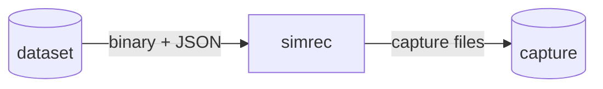
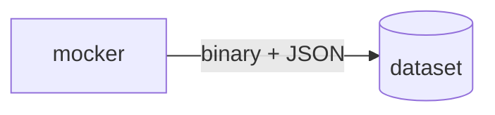
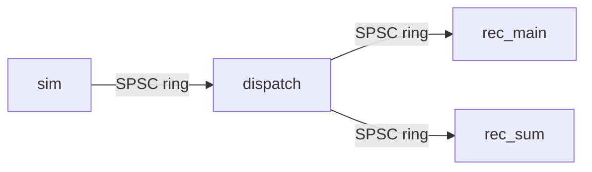
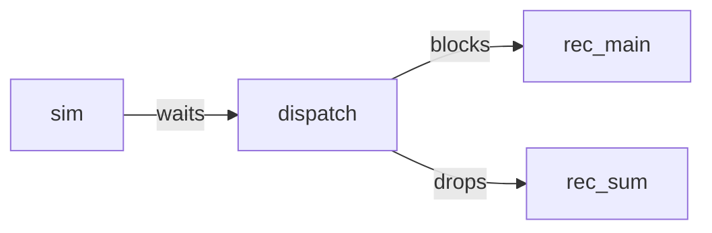
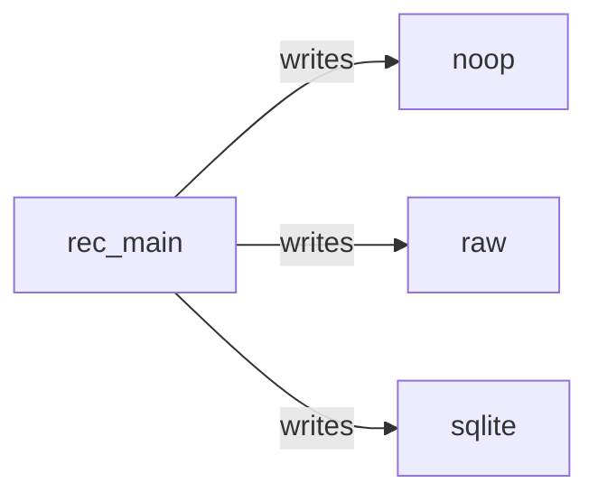
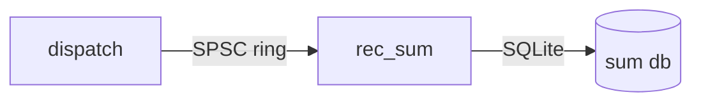
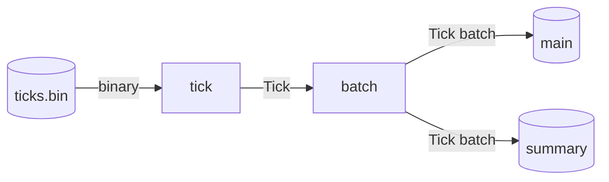
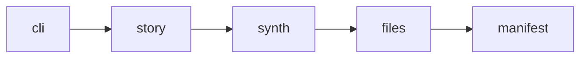
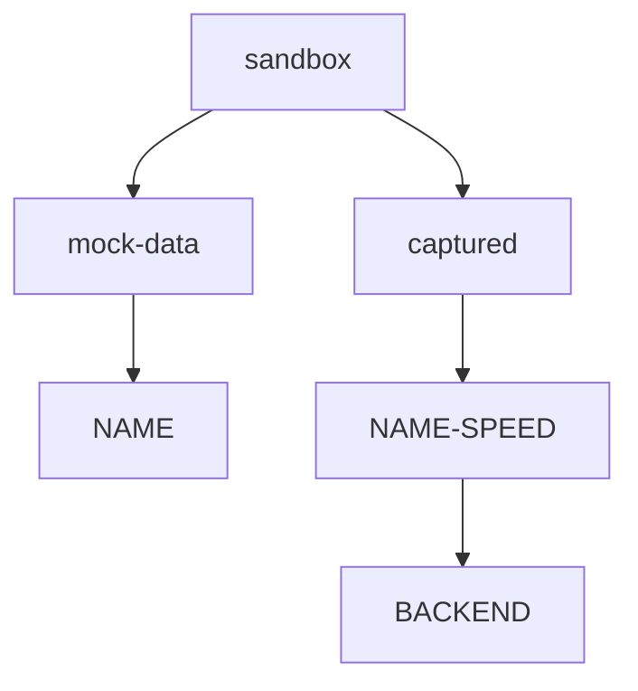
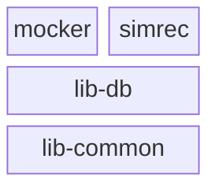

# Project Spec: rust-poc-sensor-capture

## Intent

- Generate deterministic ten-channel sensor datasets with `mocker`.

- Replay an existing dataset with `simrec`, recording it through one selected backend and optionally producing a 2 Hz summary.

- Compare SQLite WAL capture with append-only raw capture through output size, throughput, backpressure, flush latency, CPU, and RSS metrics.

- Support one-day datasets (17,280,000 ticks) and ten-day datasets (172,800,000 ticks), with shorter replay spans selected through the CLI.

- Expose two independent command-line programs. Neither executable launches the other; dataset generation and capture are separate runs.

- Keep the static report as development tooling, outside the capture runtime. Its dashboard contract is defined in `dev/spec-report.md`.

## Code Design

### System Overview

**Goal:** show one simrec capture execution and its input and output stores.



- **dataset**: existing input under `sandbox/mock-data/NAME/`.
  - `ticks.bin`: headerless sensor records.
  - `story.jsonl`: maneuver segments.
  - `manifest.json`: metadata and dataset completion marker.

- **simrec**: replays one dataset span and writes exactly one backend folder.

- **capture**: output under `sandbox/captured/NAME-SPEED/BACKEND/`.
  - Main recording: raw segment files or `capture-main.sqlite`, absent for `noop`.
  - `capture-main-metrics.json`: main completion marker.
  - `capture-main-ostel.jsonl`: main-path and process telemetry.
  - `capture-sum.sqlite`: optional summary database.
  - `capture-sum-metrics.json`: optional summary completion marker.
  - `capture-sum-ostel.jsonl`: optional summary telemetry.

- The dataset exists before simrec starts. Mocker is not part of this execution.

### Mocker Execution

**Goal:** show the independent mocker run that creates a dataset.



- **mocker**: generates one deterministic dataset per run and exits.

- **dataset**: output under `sandbox/mock-data/NAME/`.
  - `ticks.bin`: sensor payload.
  - `story.jsonl`: maneuver segments.
  - `manifest.json`: published last to mark completion.

- Mocker is the only writer of `mock-data/`. It does not launch simrec.

- The `dataset` store is the same input store shown in System Overview.

### simrec Threads

**Goal:** show the threads inside one `simrec` process and who sends to whom.



- **sim**: `simrec-sim` reads `ticks.bin` and sends batches, paced by monotonic deadlines.

- **dispatch**: `simrec-dispatch` wraps each batch in one `Arc` and fans it out, main first.

- **rec_main**: `simrec-rec-main` batches and writes through the `Recorder` trait.

- **rec_sum**: `simrec-rec-sum` folds ticks into 2 Hz buckets in `capture-sum.sqlite`.

- `rec_sum` is absent with `--no-sum`.

- The sampler (not drawn) samples CPU and RSS. It never touches the rings, recorders, or cancellation flag, and its failure never fails the capture.

### Backpressure

**Goal:** show what happens when a ring is full.



- **sim**: keeps up to 1024 ticks pending when `sim-dispatch` is full and counts stalls.

- **dispatch**: retries a full `dispatch-rec-main` ring without reading more input.

- **rec_main**: receives every batch through the blocking main path.

- **rec_sum**: receives best-effort batches; a full `dispatch-rec-sum` ring drops and counts the whole batch.

- Sum never slows main.

- Realtime pacing turns backpressure into lateness, never into timestamp drift.

### Main Recorder

**Goal:** show the backends behind the `Recorder` trait inside simrec.



- **rec_main**: flushes by age and, when `--flush-ms` is omitted, at 8192 ticks.

- **noop**: discards ticks and reports zero bytes, measuring pipeline overhead only.

- **raw**: writes 48-byte records in hourly segment files.

- **sqlite**: writes `capture-main.sqlite` in WAL mode.
  - Primary key only for `sqlite-pk-index`.
  - Ten channel indexes for `sqlite-all-index`.

- Exactly one backend is selected for each simrec execution.

- After every worker is joined and tick conservation passes, `capture-main-metrics.json` is published last for the main path.

### Summary Path

**Goal:** show the optional summary writer inside simrec and its output store.



- **dispatch**: offers each batch once and counts batches dropped for the summary.

- **rec_sum**: folds ticks into 500 ms buckets and commits every `--sum-flush-s` seconds.

- **sum db**: `capture-sum.sqlite`, part of the `capture` store in System Overview.
  - `summary`: per-channel minimum, maximum, and average.
  - `meta`: schema and bucket metadata.

- This path is absent with `--no-sum`. Summary runtime failures do not fail the main capture.

### Replay Data Flow

**Goal:** show how simrec transforms input sensor records into capture data.



- **ticks.bin**: headerless 40-byte records, `[f32; 10]` little-endian, without timestamps.

- **tick**: decoded values plus `epoch_micro`, computed from the manifest rule.

- **batch**: at most 1024 ticks, shared after the dispatcher.
  - `Vec<Tick>` before dispatch.
  - `Arc<Vec<Tick>>` after dispatch.

- **main**: selected backend output, written in flush batches.

- **summary**: `capture-sum.sqlite`, one row per 500 ms bucket.

- Tick timestamps never come from the replay wall clock.

### Mocker Generation

**Goal:** write a complete, deterministic dataset whose manifest marks it as finished.



- **cli**: duration, seed, start-us, out, rate-hz.
- **story**: seeded maneuver segments, written to `story.jsonl`.
- **synth**: per-tick channel values from a separate seeded stream, so `story.jsonl` stays byte-identical across synthesis changes.
- **files**: `ticks.bin` and `story.jsonl`, streamed in one-second chunks, then flushed and fsynced.
~
- **manifest**: `manifest.json`, published last with a non-overwriting hard link. Its presence means the dataset is complete. A failure before this leaves partial output without a manifest.

### Artifacts on Disk

**Goal:** show where a run writes its files and why runs never share a folder.



- **sandbox**: root of all generated data, not versioned.

- **mock-data**: one folder per dataset.

- **captured**: one folder per requested span and replay speed.

- **NAME**: dataset name from the requested duration.
  - `dNNN`: whole days.
  - `mNNN`: other spans.
  - `ticks.bin`: sensor payload.
  - `story.jsonl`: maneuver segments.
  - `manifest.json`: completion marker.

- **NAME-SPEED**: requested span plus `real` or `max`, isolating parallel runs by speed.

- **BACKEND**: one backend output folder within a run.
  - `raw`
  - `sqlite-pk-index`
  - `sqlite-all-index`
  - `noop`

- Backend folders hold the recording, main metrics and telemetry, and optional summary artifacts.

- Output directories must be new or empty. Nothing is removed automatically.

### Crate Dependencies

**Goal:** show the dependency layers shared by the independent executables.



- **mocker**: uses `lib-common` for `time::now`.

- **simrec**: uses `lib-db` for SQLite access and `lib-common` for shared facilities.

- **lib-db**: uses `lib-common` for `CHANNELS`.

- **lib-common**: foundation, no internal deps.

- A part may depend only on layers below it, never sideways or up.

- The static report is not a crate and is not part of this dependency stack.

### Tech Stack

The executable and library responsibilities are:

| Component | Role | Key dependencies |
| --------- | ---- | ---------------- |
| `lib-common` | Shared SPSC facade (`event_base`), wall-clock time, macOS CPU sampling, channel names | `crossfire`, `derive_more`, `libproc` (macOS target only) |
| `lib-db` | SQLite handles, schemas, writers, and the summary reader | `lib-common`, `rusqlite` (bundled), `simple-fs`, `derive_more` |
| `mocker` | Deterministic mock dataset generator | `lib-common`, `serde`, `serde_json`, `clap`, `simple-fs`, `rand`, `rand_chacha` |
| `simrec` | Validated replay, dispatcher, main recorder, summary recorder, metrics | `lib-common`, `lib-db`, `serde`, `serde_json`, `clap`, `simple-fs`, `derive_more` |
~
- The on-disk file tree lives in `## Workspace` below.

- Language and layout:

  - Rust, edition 2021, workspace resolver 3.

  - Four crates in one workspace: `lib-common`, `lib-db`, `mocker`, and `simrec`.

  - `report/` is plain static files served beside `sandbox/`, with no bundler and no framework.

- Dependencies and lints:

  - Every dependency is declared once in `[workspace.dependencies]` and consumed with `workspace = true`.

  - `unsafe_code` is forbidden at the workspace level; the only unsafe code lives inside dependencies such as `libproc` and `rusqlite`.

- Storage and platform:

  - SQLite is compiled in through `rusqlite` with the `bundled` feature, so no system SQLite is needed.

  - Raw capture is plain `std::io::BufWriter` over hourly segment files.

  - Per-thread CPU sampling is macOS only, isolated behind `lib_common::os`; other targets report `Error::Unsupported`.

- The on-disk file tree lives in `## Workspace` below.

### Development Tooling

- `report.html` and `report/` form a static browser dashboard, served beside `sandbox/`.

- The report fetches existing manifests, metrics, and telemetry. It does not participate in generation, capture, or shutdown.

- It uses plain HTML, CSS Grid, ES modules, standard fetch, and Canvas 2D, without a build step or dependencies.

- Dashboard discovery, views, formatting, and compatibility rules are defined in `dev/spec-report.md`.

### Sensor Model

Ten channels are sampled together at 200 Hz, one tick every 5 ms. Order is fixed: it is the tick order, the manifest order, and the SQLite column order.

| # | Channel        | Unit  | Notes                          |
| - | -------------- | ----- | ------------------------------ |
| 0 | `rotor_fl_rpm` | RPM   | front-left                     |
| 1 | `rotor_fr_rpm` | RPM   | front-right                    |
| 2 | `rotor_rl_rpm` | RPM   | rear-left                      |
| 3 | `rotor_rr_rpm` | RPM   | rear-right                     |
| 4 | `accel_x_mps2` | m/s2  | body forward                   |
| 5 | `accel_y_mps2` | m/s2  | body left                      |
| 6 | `accel_z_mps2` | m/s2  | body up, about +9.81 at hover  |
| 7 | `gyro_x_rads`  | rad/s | roll rate                      |
| 8 | `gyro_y_rads`  | rad/s | pitch rate                     |
| 9 | `gyro_z_rads`  | rad/s | yaw rate                       |

- A tick is `[f32; 10]` in little-endian order, 40 bytes.
- Timestamps are wall-clock epoch microseconds, implicit in the mock input: `ts_us = start_epoch_us + i * tick_period_us`, with `tick_period_us = 5000`.
- `start_epoch_us` is captured once by the mocker at generation time (never per tick), or set with `--start-us`, and recorded in `manifest.json`.

#### Axis Convention

- Body frame FLU: x forward, y left, z up. This matches `accel_z_mps2` reading about +9.81 at hover.
- Rotation rates are positive by the right-hand rule:
  - `gyro_x_rads` > 0: rolling right (right side going down).
  - `gyro_y_rads` > 0: pitching nose down.
  - `gyro_z_rads` > 0: yawing counterclockwise seen from above (nose turning left).

### Workspace

```text
Cargo.toml              workspace, shared dependencies, lints, profiles
README.md               usage, formats, limitations, comparison procedure
.gitignore              sandbox/
crates/
  lib-common/           shared named bounded SPSC facade (event_base), os sampling, time, channels
  lib-db/               SQLite handles, schemas, writers, and the summary reader
  mocker/               deterministic mock dataset generator
  simrec/               validated replay, dispatcher, pipeline, recorders, metrics
sandbox/                generated mock datasets and captures (not versioned)
dev/                    project rules and specs
.workbench/             planning and chat workspace
```

- Workspace resolver is 3, edition stays 2021.
- Workspace lints forbid `unsafe_code`.
- Dependencies are inherited from `[workspace.dependencies]`.

### Crate: lib-common

- Provides `event_base`, a named, bounded, synchronous SPSC facade over Crossfire.
- Endpoints are single-owner and non-clonable.
- `try_send` returns the owned message when the queue is full, so no data is lost.
- `try_recv` drains queued messages before reporting sender disconnection.
- Backend handles and errors stay private.
- Errors: `InvalidCapacity`, `TxDisconnected`, `RxDisconnected`, with `is_disconnected()`.
- Provides `time::now() -> i64`, the current wall-clock time in epoch microseconds, saturating and negative before the epoch.

#### Module: lib-common::os

- Provides per-thread and process CPU time and RSS on macOS through the `libproc` crate (safe API over `proc_pidinfo`), wired as a macOS-only target dependency. The unsafe code stays inside the dependency.
- `thread_cpu_all(pid) -> Result<Vec<ThreadCpu>>` lists the threads with `ListThreads`, then reads `ThreadInfo` for each. A thread that exits before it is read is skipped.
- `process_stats(pid) -> Result<ProcessStats>` reads `TaskAllInfo`. The task CPU totals only include exited threads, so the live thread times are added.
- `ThreadCpu` holds `thread_handle: u64` (kernel handle, stable while the thread lives), `name: String` (empty if unnamed), `user_ns`, `system_ns`, and `sched_usage: f32` (`pth_cpu_usage / 10.0`, percent of one core).
- `ProcessStats` holds `user_ns`, `system_ns`, and `rss_bytes`.
- CPU times are nanoseconds as reported by `libproc` on the target machine, with no timebase conversion.
- Other targets return `Error::Unsupported`.

### Crate: lib-db

- Owns every SQLite access, so simrec and the future console do not touch `rusqlite` directly, except in tests.
- Two handle types: `DbRw` for one-thread reads and writes, `DbRo` for one-thread read-only access. Each is `!Sync` and owned by one thread.
- `DbRw::create_new(path)`:
  - Creates the empty file with `create_new(true)`, so an existing database is never overwritten.
  - Opens with `SQLITE_OPEN_READ_WRITE | SQLITE_OPEN_NO_MUTEX`.
  - Sets `journal_mode=WAL` and `synchronous=NORMAL` and reads both back. This is the only place the pragmas are checked.
- `DbRo::open(path)`:
  - Opens with `SQLITE_OPEN_READ_ONLY | SQLITE_OPEN_NO_MUTEX`.
  - Sets `query_only=ON` and `busy_timeout` of 1000 ms, so read-only code cannot write and WAL readers do not block the writer.
- `schema::main`:
  - `create_main(db, all_index)` creates the `samples` table with `ts_epoch_micro INTEGER PRIMARY KEY` and the ten `REAL` channels in tick order, plus the ten `idx_samples_<channel>` indexes when `all_index` is set.
  - `SamplesWriter::write_batch(&mut self, ticks: &[Tick])` binds 11 values per tick through a cached prepared statement, one transaction per nonempty batch. A failed batch rolls back as a whole.
- `schema::sum`:
  - `create_sum(db, bucket_us, start_epoch_us)` creates `summary` and `meta` and writes the metadata rows.
  - `SumWriter::write_rows(&mut self, rows: &[SumRow])` binds 32 values per row through a cached prepared statement, one transaction per nonempty slice.
  - `SumReader` wraps a `DbRo` and exposes `bucket_us()`, `rows_after(ts, limit)`, and `latest(n)`, for the console and for tests.
- `files::db_file_bytes(path)` returns the database plus its `-wal` and `-shm` files, used for `output_bytes` in both metrics files.

### Crate: mocker

- Depends on `lib-common` for `time::now()`, called once per generation.

#### Generation Lifecycle

1. Validate duration and timestamp bounds before creating output files.
2. Generate seeded maneuver segments for `story.jsonl`.
3. Synthesize channel values from a separate seeded stream, preserving story determinism across synthesis changes.
4. Stream data in one-second chunks, then flush and synchronize both data files.
5. Publish `manifest.json` with a non-overwriting hard link as the completion marker.

#### CLI

| Arg          | Default     | Notes                                      |
| ------------ | ----------- | ------------------------------------------ |
| `--duration` | `d1`        | `d<N>`, `h<N>`, or `m<N>`, N positive      |
| `--seed`     | `42`        | reproducible for the same build            |
| `--start-us` | now         | epoch microseconds start, positive         |
| `--out`      | `sandbox`   | dataset in `<out>/mock-data/<name>`        |
| `--rate-hz`  | `200`       | only `200` is accepted                     |

#### Output

- `ticks.bin`: headerless little-endian `[f32; 10]` records, 40 bytes per tick.
- `story.jsonl`: contiguous half-open `[start_tick, end_tick)` maneuver segments with `maneuver` and `intensity`.
- `manifest.json`: version 3 completion record, schema below.
- The manifest is written last and is the completion marker.
- `ticks.bin` and `story.jsonl` carry no timestamps; tick timestamps follow the manifest rule.
- Same-seed datasets differ in `start_epoch_us` unless `--start-us` is given. The tick data is still identical.

##### story.jsonl schema

One compact JSON object per line, in segment order. Segments are contiguous and cover `[0, tick_count)`.

```json
{"start_tick":0,"end_tick":36000,"maneuver":"hover","intensity":0.6234}
```

- `start_tick`, `end_tick`: `u64`, half-open range in ticks.
- `maneuver`: one of `hover`, `climb`, `descend`, `forward`, `backward`, `bank_left`, `bank_right`, `yaw_cw`, `yaw_ccw`, `gust`.
- `intensity`: `f32` in `[0.2, 1.0]`.
- `ramp_ticks` is internal and is never written.

##### manifest.json schema

Pretty-printed JSON with a trailing newline. All keys are always present.

```json
{
  "version": 3,
  "seed": 42,
  "rate_hz": 200,
  "channels": [
    "rotor_fl_rpm",
    "rotor_fr_rpm",
    "rotor_rl_rpm",
    "rotor_rr_rpm",
    "accel_x_mps2",
    "accel_y_mps2",
    "accel_z_mps2",
    "gyro_x_rads",
    "gyro_y_rads",
    "gyro_z_rads"
  ],
  "tick_count": 17280000,
  "start_epoch_us": 1792022400000000,
  "tick_period_us": 5000,
  "bytes_per_tick": 40
}
```

- `version`: `u32`, currently `3`.
- `seed`: `u64`, the generator seed.
- `rate_hz`: `u32`, always `200`.
- `channels`: array of ten strings in tick order.
- `tick_count`: `u64`, total ticks. `ticks.bin` must be exactly `tick_count * 40` bytes.
- `start_epoch_us`: `i64`, positive, epoch microseconds of the first tick, captured once at generation or set by `--start-us`.
- `tick_period_us`: `i64`, always `5000`.
- `bytes_per_tick`: `usize`, always `40`.
- Tick timestamp rule: `ts_us = start_epoch_us + i * tick_period_us`. `start_epoch_us + tick_count * tick_period_us` must fit in `i64`.

#### Synthesis

- Seeded weighted random walk over ten maneuvers, lasting 3 to 60 seconds (gusts up to 8 seconds).
- Smooth ramps of 0.5 to 1 second between effects.
- Slow baseline drift, rotor noise, and acceleration ripple.
- Story and synthesis use separate seeded ChaCha8 streams.
- Data is streamed in one-second chunks through buffered output. Memory use does not grow with duration.

This is a plausible, simplified model, not a physics simulation. Existing rotor and `accel_z_mps2` behavior is kept.

##### Attitude and Rates

- Synthesis state tracks roll and pitch angles in radians and a yaw rate.
- Each maneuver sets a target angle. The angle moves to the target with the smoothstep ramp (`segment.ramp_ticks`, 0.5 to 1 s), and back to 0 when the next segment ramps in.
- `gyro_x_rads` and `gyro_y_rads` are the per-tick derivative of the ramped roll and pitch: `(angle[i] - angle[i - 1]) * 200.0`. Rates are smooth pulses on entry and exit, near zero while the attitude is held, and integrate back to zero when the craft levels out.
- Yaw is a rate, not an angle: `gyro_z_rads` ramps to a sustained target rate during yaw maneuvers.

##### Maneuver Mapping

`I` is the segment intensity in `[0.2, 1.0]`. Angles are radians (0.35 rad is about 20 degrees), rates are rad/s. `accel_x_mps2` and `accel_y_mps2` follow the same ramp factor as the attitude.

| Maneuver     | Roll target | Pitch target | Yaw rate target | accel_x_mps2 | accel_y_mps2 | Notes                                 |
| ------------ | ----------- | ------------ | --------------- | ------------ | ------------ | ------------------------------------- |
| `hover`      | 0           | 0            | 0               | 0            | 0            | baseline only                         |
| `climb`      | 0           | 0            | 0               | 0            | 0            | existing `accel_z` and rotor behavior |
| `descend`    | 0           | 0            | 0               | 0            | 0            | existing `accel_z` and rotor behavior |
| `forward`    | 0           | +0.35*I      | 0               | +2.0*I       | 0            | nose down                             |
| `backward`   | 0           | -0.35*I      | 0               | -2.0*I       | 0            | nose up                               |
| `bank_left`  | -0.35*I     | 0            | 0               | 0            | +2.0*I       | left side down                        |
| `bank_right` | +0.35*I     | 0            | 0               | 0            | -2.0*I       | right side down                       |
| `yaw_cw`     | 0           | 0            | -0.8*I          | 0            | 0            | nose turning right                    |
| `yaw_ccw`    | 0           | 0            | +0.8*I          | 0            | 0            | nose turning left                     |
| `gust`       | random      | random       | random          | burst        | burst        | see Gust                              |

##### Gust

- Short random-direction bursts, shaped by the gust envelope `sin^2(pi * phase)` and scaled by `I`.
- `accel_x_mps2`, `accel_y_mps2`: random burst amplitude in `[-3.0, +3.0] * I`.
- `accel_z_mps2`: keeps its existing deterministic gust term (`+3.0 * I * envelope`).
- `gyro_x_rads`, `gyro_y_rads`: random burst amplitude in `[-1.5, +1.5] * I`, added on top of the attitude derivative.
- Roll and pitch targets: random in `[-0.1, +0.1] * I` rad.
- Yaw rate target: random in `[-0.5, +0.5] * I` rad/s.
- Gust parameters are drawn once per gust segment from the synthesis stream when the segment begins.

##### Noise and Drift

- Accel x/y: Gaussian noise, std 0.05 m/s2.
- Gyro x/y/z: Gaussian noise, std 0.005 rad/s, plus a slow bias drift per axis bounded to +/-0.002 rad/s. The per-tick random walk step is uniform in `[-2e-6, +2e-6]` rad/s.
- The existing rotor noise (uniform +/-12) and `accel_z` noise and ripple are kept.
- Gaussian draws use a local Box-Muller helper over the ChaCha8 synthesis stream, so no extra dependency is needed.

##### Determinism

- All draws come from the seeded synthesis stream, so output is deterministic for the same seed and build.
- Per-tick draw order: the existing draws first (4 rotors, accel z), then accel x, accel y, gyro bias steps (x, y, z), and gyro noise (x, y, z).
- The story stream is unchanged, so for a given seed `story.jsonl` stays byte-identical to the previous build. Only the synthesis stream draws more values.

#### Completion

- Data files are flushed and synchronized before the manifest is published.
- The manifest is published with a non-overwriting hard link, so hard-link support is required.
- A failure before publication leaves partial output without `manifest.json`.
- Start and end timestamps are validated before any output file is created.

### Crate: simrec

#### CLI

| Arg           | Default     | Notes                                       |
| ------------- | ----------- | ------------------------------------------- |
| `--noop`      | (one of)    | pipeline diagnostic, writes no recording    |
| `--sql`       | (one of)    | SQLite WAL backend                          |
| `--raw`       | (one of)    | hourly raw binary backend                   |
| `--with-index` | (off)      | with `--sql` only; adds ten per-channel indexes |
| `--duration`  | `d1`        | input dataset, `d<N>`, `h<N>`, `m<N>`       |
| `--out`       | `sandbox`   | `<out>/captured/<name>-<speed>/<backend>/`   |
| `--flush-ms`  | `100`       | interval; 8192-tick size cap only if omitted |
| `--speed`     | `real`      | `real` (deadline pacing) or `max`           |
| `--ring-cap`  | `4096`      | ring capacity in messages, 1 to 65536       |
| `--sample-ms` | `1000`      | CPU sampling interval in ms, positive       |
| `--no-sum` | (off) | disable the summary, no `capture-sum-*` files |
| `--sum-flush-s` | `1` | summary commit interval in seconds, positive |
| `--sum-ring-cap` | `256` | `dispatch-rec-sum` ring capacity in tick-batch messages, 1 to 65536 |

- Exactly one backend flag is required.
- `--duration` accepts `d<N>`, `h<N>`, or `m<N>` with N positive.
- Input resolution: up to one day uses `mock-data/d001`, falling back to `mock-data/d010`. Spans above one day up to ten days use `mock-data/d010`. Longer spans are rejected. The replay is truncated to the requested span from the start of the dataset: the tick count is the duration in seconds times 200. For example, `--duration m5` replays the first 60,000 ticks of `d001`, and `--duration d1` replays all 17,280,000 ticks. The run folder uses the requested duration name, so `--duration m5` writes to `captured/m005-<speed>/`, and `--duration d1` writes to `captured/d001-<speed>/`.
- Output directories must be new or empty. Nothing is removed automatically.
- Run folder is `<name>-<speed>`, with `real` for `--speed real` and `max` for `--speed max`. Each speed has its own folder, so real and max runs of one dataset and backend can run in parallel.

#### Module layout

- `main.rs` wires modules and delegates to `app.rs`.
- `app.rs` turns the CLI into a capture config, resolves the dataset, prepares the output, checks conservation, and publishes metrics.
- `cli.rs` holds the clap parser and the duration, dataset, and ring-capacity helpers.
- `sim/` holds the validated input (`input.rs`) and the paced producer (`producer.rs`).
- `dispatcher/` holds the fan-out worker (`dispatch.rs`).
- `rec/rec_main/` holds the main recorder: the batching consumer (`consumer.rs`), the `Recorder` trait (`recorder.rs`), the raw recorder (`raw.rs`), and the SQLite recorder (`sqlite.rs`).
- `rec/rec_sum/` holds the summary: the bucket accumulator (`accum.rs`) and the summary consumer (`consumer.rs`).
- `metrics/` holds the histogram (`flush-histogram.rs`), the publication helper (`publish.rs`), and the two metrics documents (`main-metrics.rs`, `sum-metrics.rs`).
- `ostel/` holds the sampler (`sampler.rs`).
- `run.rs` owns the rings, the named scoped threads, the shutdown order, cancellation, and error merging. It is the only module that knows every thread.
- `sim` does not import from `dispatcher` or `rec`. `rec_main` and `rec_sum` do not import from each other. `ostel` does not import from `rec_sum`.

#### Threads and rings

| Ring | Message | Capacity flag | Default |
| ---- | ------- | ------------- | ------- |
| `sim-dispatch` | `Vec<Tick>`, at most 1024 ticks | `--ring-cap` | 4096 |
| `dispatch-rec-main` | `Arc<Vec<Tick>>` | `--ring-cap` | 4096 |
| `dispatch-rec-sum` | `Arc<Vec<Tick>>` | `--sum-ring-cap` | 256 |

- Thread names: `simrec-sim`, `simrec-dispatch`, `simrec-rec-main`, `simrec-rec-sum`, `simrec-sampler`.
- Ring names are passed to `event_base`, so errors name the ring.
- With `--no-sum`, the `dispatch-rec-sum` ring and the `simrec-rec-sum` thread do not exist.

##### Dispatcher

- Receives a `Vec<Tick>` from `sim-dispatch`, wraps it once in `Arc<Vec<Tick>>` (no copy), and sends:
  - blocking to `dispatch-rec-main`, retrying with a short backoff while the ring is full, without reading `sim-dispatch`, so backpressure reaches sim;
  - best effort to `dispatch-rec-sum`, once. A full ring drops the whole batch for sum and counts it. A disconnected receiver stops sum sends and counts every later batch.
- Main is always sent before sum, so a sum problem cannot delay main.
- `dispatch_stall_count` counts one per batch that found `dispatch-rec-main` full at least once. This differs from sim's `stall_count`, which counts every full attempt on `sim-dispatch`.
- End of stream follows the sim/rec pattern:
  - A plain disconnect is not success, because sim also drops its sender on failure.
  - The dispatcher finishes only when `sim_done` is set and a final recheck of `sim-dispatch` is empty. Otherwise it keeps waiting on `cancelled`.
  - On success it sets `dispatch_done` and drops both senders, so both recorders finish.
- It holds a cancellation guard, like `simrec-sim` and `simrec-rec-main`. A main-path failure in any of the three cancels the others.

#### Startup Validation

- Manifest version 3, channel order, 200 Hz, 40-byte records, 5000 us tick period, positive tick count.
- Versions 1 and 2 are rejected with an error asking to regenerate the dataset.
- `channels` must equal the ten names exactly, in order.
- Checked payload size. `start_epoch_us` must be positive, and `start_epoch_us + tick_count * tick_period_us` must fit in `i64` (checked arithmetic).
- `ticks.bin` size must equal `tick_count * 40` exactly.
- `manifest.json`, `ticks.bin`, and `story.jsonl` must be regular files. The story is not parsed.

#### Pipeline

- Producer thread reads `ticks.bin` through a bounded buffered reader and decodes little-endian floats.
- Non-finite values, premature EOF, and trailing bytes fail replay.
- Realtime pacing uses deadlines anchored to a monotonic start, so backpressure creates lateness rather than timestamp drift.
- Tick timestamps (`epoch_micro`) are computed from the manifest rule, never from the wall clock. Pacing and data timestamps stay separate.
- Ticks travel in `Vec<Tick>` messages of at most 1024 ticks.
- A full ring keeps pending ticks in the producer. Stalls are counted. Input pauses when pending reaches 1024 ticks.
- Consumer thread appends ticks to a batch and flushes when the interval elapses. Without `--flush-ms`, the interval is 100 ms and a batch is also flushed at 8192 ticks. With `--flush-ms`, there is no tick cap.
- Final draining happens only after the dispatcher publishes success on `dispatch_done` and the ring is rechecked.
- Every worker is joined before completion is reported.
- Threads are named `simrec-sim` (producer), `simrec-dispatch` (fan-out), `simrec-rec-main` (main recorder), `simrec-rec-sum` (summary writer, unless `--no-sum`), and `simrec-sampler` (CPU sampler, when enabled).
- Tick conservation is required: produced, dispatched, and recorded counts must equal the replayed tick count, which is the requested span in ticks.

#### Recorder Trait

- `write_batch(&mut self, ticks: &[Tick]) -> Result<()>`
- `finish(self: Box<Self>) -> Result<u64>`, returning output bytes.

#### Backends

- No-op: discards ticks. Reports zero output bytes. It measures pipeline overhead only.
- SQLite: `sandbox/captured/<name>-<speed>/sqlite-pk-index/capture-main.sqlite` or `sandbox/captured/<name>-<speed>/sqlite-all-index/capture-main.sqlite` (the all-index variant is selected by `--with-index`), WAL journal mode, `synchronous=NORMAL`. Table `samples` with `ts_epoch_micro` (epoch microseconds) as primary key and ten `REAL` channels in tick order, plus ten secondary indexes, one per channel (`idx_samples_rotor_fl_rpm` through `idx_samples_gyro_z_rads`), in the all-index variant only. Each nonempty batch is one transaction with a cached prepared statement binding 11 values. Finalization closes the connection and counts the database plus any remaining `-wal` and `-shm` files.
- Raw: `sandbox/captured/<name>-<speed>/raw/capture-main-seg-000000.bin` and so on. Each record is 48 bytes: little-endian `i64` `ts_epoch_micro` (epoch microseconds) followed by ten `f32` values. Each segment holds one hour (720,000 ticks), 34,560,000 bytes, including a rotation inside a batch. Writes use `BufWriter`, flushed on rotation and finalization. `output_bytes` is the sum of finalized segment sizes.

#### Failure Handling

- Each worker holds a cancellation guard that signals the other main-path workers on error or panic.
- Pacing and retry waits check cancellation.
- When several workers fail, the first non-peer error in the order sim, dispatch, rec_main is preserved.
- Cancellation cannot interrupt a blocked file read or a recorder call that never returns.

#### Metrics

- Published to `<out>/captured/<name>-<speed>/<backend>/capture-main-metrics.json` for every backend, only after successful replay, finalization, and tick conservation.

- Configuration: backend, speed, `flush_ms`, `ring_cap`, batch and pending limits.
- Throughput: `wall_time_s`, `ticks_total`, `ticks_per_s`.
- Pipeline: `stall_count`, `dispatch_stall_count`, `max_pending_len`.
- Flushes: `flush_count`, `flush_ms_p50`, `flush_ms_p99`, `flush_ms_max`, with power-of-two bucket estimates.
- Finalization: `finish_ms`.
- Size: `output_bytes`.
- Publication uses a synced temporary file and a non-overwriting hard link.

##### capture-main-metrics.json schema

Pretty-printed JSON with a trailing newline. The schema is the same for every backend, and all keys are always present.

```json
{
  "backend": "noop",
  "speed": "max",
  "flush_ms": 100,
  "ring_cap": 4096,
  "max_pending_ticks": 1024,
  "max_batch_ticks": 8192,
  "ticks_total": 17280000,
  "wall_time_s": 12.5,
  "ticks_per_s": 1382400.0,
  "stall_count": 0,
  "dispatch_stall_count": 0,
  "max_pending_len": 0,
  "flush_count": 2110,
  "flush_ms_p50": 0.262144,
  "flush_ms_p99": 1.048576,
  "flush_ms_max": 2.097152,
  "percentile_method": "nearest-rank power-of-two nanosecond bucket upper bound",
  "finish_ms": 0.01,
  "output_bytes": 0
}
```

| Field | Type | Notes |
| ----- | ---- | ----- |
| `backend` | string | `noop`, `raw`, `sqlite-pk-index`, or `sqlite-all-index` |
| `speed` | string | `real` or `max` |
| `flush_ms` | u64 | configured consumer flush interval |
| `ring_cap` | usize | ring capacity in messages |
| `max_pending_ticks` | usize | producer pending limit, currently 1024 |
| `max_batch_ticks` | usize | consumer batch limit, currently 8192 |
| `ticks_total` | u64 | ticks recorded by the consumer |
| `wall_time_s` | f64 | replay wall time in seconds |
| `ticks_per_s` | f64 | `ticks_total / wall_time_s`, `0.0` when wall time is zero |
| `stall_count` | u64 | producer ring-full events |
| `dispatch_stall_count` | u64 | batches that found the `dispatch-rec-main` ring full at least once |
| `max_pending_len` | usize | peak pending ticks in the producer |
| `flush_count` | u64 | number of consumer flushes |
| `flush_ms_p50` | f64 | flush latency estimate in ms, power-of-two bucket upper bound |
| `flush_ms_p99` | f64 | flush latency estimate in ms, power-of-two bucket upper bound |
| `flush_ms_max` | f64 | exact maximum flush latency in ms |
| `percentile_method` | string | fixed description of the percentile estimate |
| `finish_ms` | f64 | recorder finalization time in ms |
| `output_bytes` | u64 | finalized output bytes, `0` for noop |

#### CPU Sampling

- A sampler thread (`simrec-sampler`) starts after the sim and rec threads and stops after both are joined.
- It never touches the ring, the recorder, the worker metrics, or the shared `cancelled` flag.
- Every `--sample-ms`, it reads per-thread and process CPU through `lib_common::os`, writes one JSONL line per thread plus one process line, then flushes.
- `cpu_pct` is the CPU-time delta over the monotonic interval, where 100.0 means one full core.
- The first sample of each thread and of the process has `cpu_pct` null.
- A final sample is taken after all workers are joined, so runs shorter than one interval still get a CPU delta.
- Threads are keyed by handle and label, so a reused handle does not inherit an old delta.
- A sampler error never fails the capture. The sampler writes one `error` line, prints one warning to stderr, and stops.
- If the sampler thread cannot start, the capture continues without sampling.
- Output is `<out>/captured/<name>-<speed>/<backend>/capture-main-ostel.jsonl`, created with `create-new` before the replay starts, so a creation failure is a setup error. The `simrec-rec-sum` thread lines go to `capture-sum-ostel.jsonl` in the same way, unless `--no-sum`.
- Both files are written for every backend, including `noop`, and are not covered by the metrics completion markers.
- Activity after the last sample (up to one interval) is not captured.

##### capture-main-ostel.jsonl schema

One compact JSON object per line, with a `kind` discriminator. All lines for one sample share the same `seq` and `ts_epoch_us`.

```json
{"kind":"thread","seq":3,"ts_epoch_us":1792022403000000,"interval_us":1000412,"thread":"simrec-rec-main","user_ns":812000000,"system_ns":95000000,"cpu_pct":41.7,"sched_usage":40.3}
{"kind":"process","seq":3,"ts_epoch_us":1792022403000000,"interval_us":1000412,"user_ns":1020000000,"system_ns":140000000,"cpu_pct":48.2,"rss_bytes":38211584}
{"kind":"error","seq":4,"ts_epoch_us":1792022404000000,"message":"proc_pidinfo failed: ..."}
```

| Field | Type | Notes |
| ----- | ---- | ----- |
| `kind` | string | `thread`, `process`, or `error` |
| `seq` | u64 | sample number, starting at 0 |
| `ts_epoch_us` | i64 | wall-clock epoch microseconds at the sample |
| `interval_us` | u64 | monotonic time since the previous sample, `0` for the first |
| `thread` | string | pthread name; unnamed threads use `tid-<n>` |
| `user_ns`, `system_ns` | u64 | cumulative CPU time in nanoseconds |
| `cpu_pct` | f64 or null | delta CPU over the interval, 100 = one core |
| `sched_usage` | f32 | kernel decayed usage, thread lines only |
| `rss_bytes` | u64 | process lines only |
| `message` | string | error lines only |

## Summary Database

### Summary Database

The Summary Path diagram defines the writer topology. This section defines its bucket, storage, metrics, and read-only consumer contracts.

- `simrec-rec-sum` receives tick batches from the dispatcher. It accumulates one bucket at a time (min, max, and sum as `f64` per channel, plus the tick count), keyed by `bucket_us = epoch_micro - epoch_micro.rem_euclid(SUM_BUCKET_US)` from the tick timestamp, with `SUM_BUCKET_US = 500_000`.
- A batch that finds the `dispatch-rec-sum` ring full is dropped by the dispatcher and counted as `ticks_dropped` and `batches_dropped`. `simrec-rec-sum` never waits.
- `simrec-rec-sum` commits every `--sum-flush-s` seconds and at disconnect, and ends on sender disconnection. It holds no cancellation guard and never reads or sets the `cancelled` flag.
- A summary error never fails the main capture. `simrec-rec-sum` prints one warning through the app, and `capture-sum-metrics.json` is not published.
- Creating `capture-sum.sqlite` or `capture-sum-ostel.jsonl` is a setup error and fails the run, like the main ostel file.

#### capture-sum.sqlite

```sql
CREATE TABLE meta (
    key   TEXT PRIMARY KEY,
    value TEXT NOT NULL
);

CREATE TABLE summary (
    ts_epoch_micro INTEGER PRIMARY KEY,
    tick_count INTEGER NOT NULL,
    rotor_fl_rpm_min REAL, rotor_fl_rpm_max REAL, rotor_fl_rpm_avg REAL,
    rotor_fr_rpm_min REAL, rotor_fr_rpm_max REAL, rotor_fr_rpm_avg REAL,
    rotor_rl_rpm_min REAL, rotor_rl_rpm_max REAL, rotor_rl_rpm_avg REAL,
    rotor_rr_rpm_min REAL, rotor_rr_rpm_max REAL, rotor_rr_rpm_avg REAL,
    accel_x_mps2_min REAL, accel_x_mps2_max REAL, accel_x_mps2_avg REAL,
    accel_y_mps2_min REAL, accel_y_mps2_max REAL, accel_y_mps2_avg REAL,
    accel_z_mps2_min REAL, accel_z_mps2_max REAL, accel_z_mps2_avg REAL,
    gyro_x_rads_min REAL, gyro_x_rads_max REAL, gyro_x_rads_avg REAL,
    gyro_y_rads_min REAL, gyro_y_rads_max REAL, gyro_y_rads_avg REAL,
    gyro_z_rads_min REAL, gyro_z_rads_max REAL, gyro_z_rads_avg REAL
);
```

- WAL journal mode and `synchronous=NORMAL`, the same as the main recording, so readers can query while the writer commits.
- `meta` holds `schema_version`, `bucket_us = 500000`, `channels` (JSON array of the ten names), and `start_epoch_us` from the manifest, written once at creation.
- `summary` columns follow channel order with `_min`, `_max`, and `_avg`. The insert binds 32 values.
- `avg = sum / tick_count`. A full 500 ms bucket has `tick_count = 100`. Partial first and last rows appear when the start is not on a bucket boundary, and a dropped batch also lowers a bucket's `tick_count`.
- Primary key only, no value indexes, so a day is 172,800 rows.
- Written for every backend, including `noop`. Not written with `--no-sum`.

#### capture-sum-metrics.json

- Published after `simrec-rec-sum` is joined and finalized, and after the summary conservation check passes.
- Pretty-printed JSON with a trailing newline, all keys always present, published with the same synced temporary file and hard-link rule as the main metrics.
- Keys: `backend` (always `sqlite-sum`), `speed`, `bucket_us`, `sum_flush_s`, `sum_ring_cap`, `ticks_received`, `ticks_dropped`, `batches_dropped`, `rows_written`, `partial_rows`, `wall_time_s`, `rows_per_s`, `flush_count`, `flush_ms_p50`, `flush_ms_p99`, `flush_ms_max`, `percentile_method`, `finish_ms`, and `output_bytes`.

```json
{
  "backend": "sqlite-sum",
  "speed": "max",
  "bucket_us": 500000,
  "sum_flush_s": 1,
  "sum_ring_cap": 256,
  "ticks_received": 17280000,
  "ticks_dropped": 0,
  "batches_dropped": 0,
  "rows_written": 172800,
  "partial_rows": 0,
  "wall_time_s": 6.1,
  "rows_per_s": 28327.9,
  "flush_count": 7,
  "flush_ms_p50": 4.194304,
  "flush_ms_p99": 8.388608,
  "flush_ms_max": 7.9,
  "percentile_method": "nearest-rank power-of-two nanosecond bucket upper bound",
  "finish_ms": 1.2,
  "output_bytes": 18874368
}
```

| Field | Type | Notes |
| ----- | ---- | ----- |
| `backend` | string | always `sqlite-sum` |
| `speed` | string | `real` or `max` |
| `bucket_us` | i64 | `SUM_BUCKET_US`, always `500000` |
| `sum_flush_s` | u64 | summary commit interval in seconds |
| `sum_ring_cap` | usize | `dispatch-rec-sum` capacity in messages |
| `ticks_received` | u64 | ticks folded into rows by the summary thread |
| `ticks_dropped` | u64 | ticks the dispatcher could not offer to sum |
| `batches_dropped` | u64 | tick batches the dispatcher dropped for sum |
| `rows_written` | u64 | `summary` rows committed |
| `partial_rows` | u64 | rows with `tick_count < 100`, at the ends or from dropped batches |
| `wall_time_s` | f64 | summary thread run time |
| `rows_per_s` | f64 | `rows_written / wall_time_s`, `0.0` when zero |
| `flush_count` | u64 | number of commits |
| `flush_ms_p50`, `flush_ms_p99`, `flush_ms_max` | f64 | commit latency estimates in ms |
| `percentile_method` | string | fixed description of the estimate |
| `finish_ms` | f64 | finalization time in ms |
| `output_bytes` | u64 | database file plus sidecars |

#### Summary conservation

- `ticks_received + ticks_dropped == ticks_total` of the main capture.
- The sum of `tick_count` over every `summary` row equals `ticks_received`.
- A failed check prints to stderr and skips `capture-sum-metrics.json`. The main capture still succeeds.

#### Shutdown order

1. `simrec-sim` finishes, publishes `sim_done`, and drops its sender.
2. `simrec-dispatch` drains `sim-dispatch`, sends the last batches, publishes `dispatch_done`, and drops both senders.
3. `simrec-rec-main` drains `dispatch-rec-main`, flushes, and calls `Recorder::finish`.
4. Sim, dispatch, and main are joined. Main tick conservation is checked.
5. `simrec-rec-sum` is joined, the summary database is finalized, and summary conservation is checked.
6. A final sampler sample is taken, then `simrec-sampler` is stopped and joined.
7. `capture-main-metrics.json` is published, then `capture-sum-metrics.json`.

#### Console contract

- Open `capture-sum.sqlite` read-only through `lib_db::SumReader`. Wait if it does not exist yet.
- Startup: `SumReader::latest(120)`, reversed, fills the live view. At 2 Hz, that is a 60-second window.
- Live: poll `SumReader::rows_after(last_ts, 120)` every 500 ms, or slower, and append the returned rows.
- Read `bucket_us` from `meta` once, so a future bucket change is visible without hardcoding it.
- Keep read transactions short so WAL checkpoints are not held back.
- Maneuver labels come from `story.jsonl` in the dataset, not from the summary.

### Conventions

- One `Error` enum and `Result` alias per crate.
- Paths use `simple_fs::SPath`.
- `main.rs` only wires modules and delegates to `app.rs`.
- Tests live in each module under `// region: --- Tests`, or in sibling files for large suites.
- Test fixtures live under `tests-data/.tmp` and are retained without automatic cleanup.
- Module-level docs are kept in Markdown and mirrored under `docs/rustdoc` per project guidance.
- Diagrams: one concern per diagram, at most about six boxes, one- or two-word labels, plain names as IDs, `LR` for short chains and `TD` for longer ones. Details go in bold-labeled bullets under the diagram, never inside the boxes.

## Design Considerations

### Execution Boundaries

- Separate mocker and simrec runs make dataset generation reusable across backend and speed comparisons without implying orchestration between executables.

- The report remains development tooling because it reads artifacts independently and has no role in capture correctness or lifecycle.

### Determinism and Completion

- Separate story and synthesis random streams keep maneuver descriptions stable when synthesis changes.

- Manifest-derived timestamps separate recorded sensor time from replay pacing. Backpressure changes lateness, not the timestamp sequence.

- Publishing completion markers last distinguishes complete datasets and captures from interrupted output. Non-overwriting publication also prevents accidental replacement.

### Pipeline Isolation

- Blocking the main path preserves ticks and propagates pressure back to sim through bounded rings.

- Best-effort summary delivery prevents summary work from delaying main recording. Drop counters and conservation checks make that tradeoff observable.

- Shared `Arc` batches avoid copying sensor payloads during fan-out.

- SQLite ownership in `lib-db` centralizes schema and connection policy. Each database handle remains owned by one thread.

### Telemetry and Read Access

- Sampler failures remain non-fatal so observability does not become a runtime dependency of capture.

- CPU averages are sampling estimates, not complete accounting of all worker activity.

- A 2 Hz summary provides a smaller read surface than the 200 Hz recording. Short read-only transactions avoid holding back WAL checkpoints.

### Durability and Operational Limits

- Metrics and manifests show completion, not crash durability.
- Raw and SQLite outputs are not crash-safe. `synchronous=NORMAL` can lose the latest commits after power failure.
- Input files must not change during replay.
- Floating-point output is reproducible only on the same implementation, dependency set, and platform.
- Same-seed datasets differ in `start_epoch_us` unless `--start-us` is given.
- Version 1 and version 2 datasets and 5-channel captures with the old `ts_us` column must be regenerated.
- Large ring capacities can consume substantial memory.
- Sampling is macOS only. Other platforms write one `error` line. Linux (`/proc/self/task/<tid>/stat`) is a later addition behind the same `lib_common::os` API.
- Activity after the last sample (up to one interval) is not captured.

## Deferred and Later

~
- `player` crate: localhost web viewer with WebSocket control and binary frames, channel selection, and a maneuver timeline.
