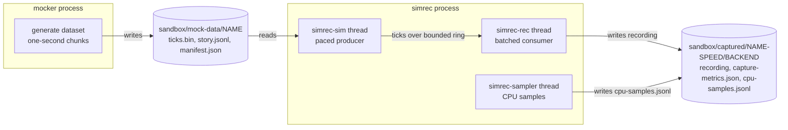
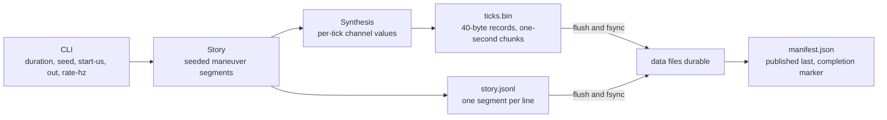
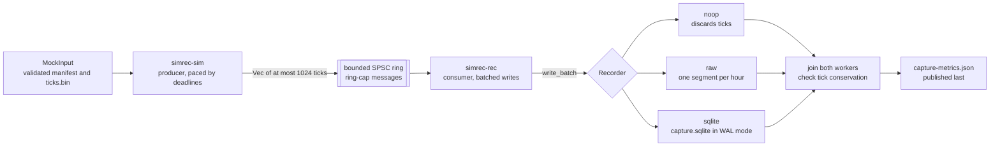
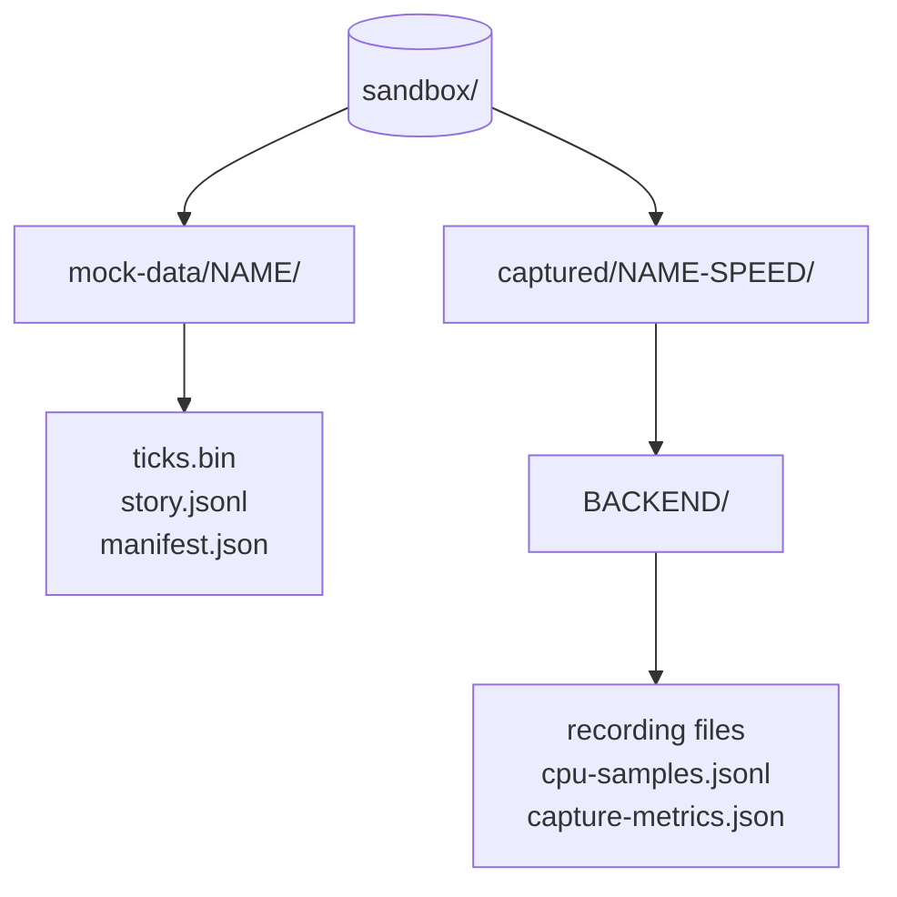
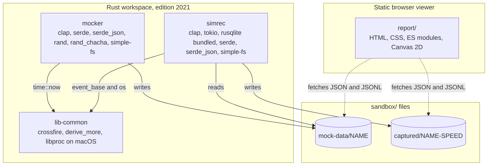

# Project Spec: rust-poc-sensor-capture

## Process Overview

The diagrams come first. Each one describes a process, its inputs and outputs, and its goal, and the detailed rules for every process follow in the later sections.

The system is two separate programs that share a workspace, a data directory, and a small support crate. `mocker` writes datasets, `simrec` reads one dataset and writes one recording, and the static `report/` page reads both.
### System Overview

**Goal:** show the running programs, their threads, and the files they exchange.



- `mocker` runs once per dataset and exits, and it is the only writer of `mock-data/`.

- `simrec` runs once per replay and writes exactly one backend folder, so one dataset can feed many runs.

- The three `simrec` threads share one process; the sampler never touches the ring, the recorder, or the cancellation flag.

- `report/` is a static browser page, not a running crate, so it appears in the tech stack diagram instead.

### Mocker Generation

**Goal:** write a complete, deterministic dataset whose manifest marks it as finished.



- Story and synthesis use separate seeded ChaCha8 streams, so `story.jsonl` stays byte-identical across synthesis changes.

- Data is streamed in one-second chunks, so memory does not grow with duration.

- `manifest.json` is published last with a non-overwriting hard link, so its presence means the dataset is complete.

- A failure before publication leaves partial output without a manifest.

### simrec Replay Pipeline

**Goal:** replay ticks at the requested pace and record each tick exactly once.



- The ring is a named, bounded, single-owner SPSC queue; a full ring returns the owned message instead of dropping it.

- Realtime pacing uses monotonic deadlines, so backpressure turns into lateness, not timestamp drift.

- The producer keeps at most 1024 pending ticks and counts stalls; the consumer flushes by age and, when enabled, by size.

- The sampler never touches the ring, the recorder, or the cancellation flag, and its failure never fails the capture.

- Both workers are joined and tick conservation is checked before `capture-metrics.json` is published.

### Artifacts on Disk

**Goal:** show where a run writes its files and why runs never share a folder.



- Dataset names encode the requested duration (`dNNN` for whole days, `mNNN` for other spans).

- Run folders add the speed suffix (`real` or `max`), so both speeds of the same dataset and backend can run in parallel.

- Backend folders are `raw`, `sqlite-pk-index`, `sqlite-all-index`, or `noop`.

- Output directories must be new or empty; nothing is removed automatically.

## Tech Stack

The diagram shows how the crates, the browser viewer, and the files on disk fit together.



| Component | Role | Key dependencies |
| --------- | ---- | ---------------- |
| `lib-common` | Shared SPSC facade (`event_base`), wall-clock time, macOS CPU sampling | `crossfire`, `derive_more`, `libproc` (macOS target only) |
| `mocker` | Deterministic mock dataset generator | `lib-common`, `serde`, `serde_json`, `clap`, `simple-fs`, `rand`, `rand_chacha` |
| `simrec` | Validated replay, capture pipeline, recorders, metrics | `lib-common`, `tokio`, `rusqlite` (bundled), `serde`, `serde_json`, `clap`, `simple-fs`, `derive_more` |
| `report/` | Static browser viewer, no build step | Plain HTML, CSS, and ES modules, Canvas 2D charts |

- Language and layout:

  - Rust, edition 2021, workspace resolver 3.

  - Three crates in one workspace: `lib-common`, `mocker`, and `simrec`.

  - `report/` is plain static files served beside `sandbox/`, with no bundler and no framework.

- Dependencies and lints:

  - Every dependency is declared once in `[workspace.dependencies]` and consumed with `workspace = true`.

  - `unsafe_code` is forbidden at the workspace level; the only unsafe code lives inside dependencies such as `libproc` and `rusqlite`.

- Storage and platform:

  - SQLite is compiled in through `rusqlite` with the `bundled` feature, so no system SQLite is needed.

  - Raw capture is plain `std::io::BufWriter` over hourly segment files.

  - Per-thread CPU sampling is macOS only, isolated behind `lib_common::os`; other targets report `Error::Unsupported`.

- The on-disk file tree lives in `## Workspace` below.

- The on-disk file tree lives in `## Workspace` below.

## Purpose

- Compare SQLite WAL capture with append-only raw binary capture for the same quadcopter sensor stream.
- Measure on-disk size, write throughput, backlog and lag, flush latency, and CPU and RSS of the capture process.
- Datasets: one day (17,280,000 ticks) and ten days (172,800,000 ticks).
- Player and query benchmarks are deferred.

## Sensor Model

Ten channels are sampled together at 200 Hz, one tick every 5 ms. Order is fixed: it is the tick order, the manifest order, and the SQLite column order.

| # | Channel        | Unit  | Notes                          |
| - | -------------- | ----- | ------------------------------ |
| 0 | `rotor_fl_rpm` | RPM   | front-left                     |
| 1 | `rotor_fr_rpm` | RPM   | front-right                    |
| 2 | `rotor_rl_rpm` | RPM   | rear-left                      |
| 3 | `rotor_rr_rpm` | RPM   | rear-right                     |
| 4 | `accel_x_mps2` | m/s2  | body forward                   |
| 5 | `accel_y_mps2` | m/s2  | body left                      |
| 6 | `accel_z_mps2` | m/s2  | body up, about +9.81 at hover  |
| 7 | `gyro_x_rads`  | rad/s | roll rate                      |
| 8 | `gyro_y_rads`  | rad/s | pitch rate                     |
| 9 | `gyro_z_rads`  | rad/s | yaw rate                       |

- A tick is `[f32; 10]` in little-endian order, 40 bytes.
- Timestamps are wall-clock epoch microseconds, implicit in the mock input: `ts_us = start_epoch_us + i * tick_period_us`, with `tick_period_us = 5000`.
- `start_epoch_us` is captured once by the mocker at generation time (never per tick), or set with `--start-us`, and recorded in `manifest.json`.

### Axis Convention

- Body frame FLU: x forward, y left, z up. This matches `accel_z_mps2` reading about +9.81 at hover.
- Rotation rates are positive by the right-hand rule:
  - `gyro_x_rads` > 0: rolling right (right side going down).
  - `gyro_y_rads` > 0: pitching nose down.
  - `gyro_z_rads` > 0: yawing counterclockwise seen from above (nose turning left).

## Workspace

```text
Cargo.toml              workspace, shared dependencies, lints, profiles
README.md               usage, formats, limitations, comparison procedure
.gitignore              sandbox/
crates/
  lib-common/           shared named bounded SPSC facade (event_base), os sampling, time
  mocker/               deterministic mock dataset generator
  simrec/               validated replay, pipeline, recorders, metrics
sandbox/                generated mock datasets and captures (not versioned)
dev/                    project rules and specs
.workbench/             planning and chat workspace
```

- Workspace resolver is 3, edition stays 2021.
- Workspace lints forbid `unsafe_code`.
- Dependencies are inherited from `[workspace.dependencies]`.

## Crate: lib-common

- Provides `event_base`, a named, bounded, synchronous SPSC facade over Crossfire.
- Endpoints are single-owner and non-clonable.
- `try_send` returns the owned message when the queue is full, so no data is lost.
- `try_recv` drains queued messages before reporting sender disconnection.
- Backend handles and errors stay private.
- Errors: `InvalidCapacity`, `TxDisconnected`, `RxDisconnected`, with `is_disconnected()`.
- Provides `time::now() -> i64`, the current wall-clock time in epoch microseconds, saturating and negative before the epoch.

### Module: lib-common::os

- Provides per-thread and process CPU time and RSS on macOS through the `libproc` crate (safe API over `proc_pidinfo`), wired as a macOS-only target dependency. The unsafe code stays inside the dependency.
- `thread_cpu_all(pid) -> Result<Vec<ThreadCpu>>` lists the threads with `ListThreads`, then reads `ThreadInfo` for each. A thread that exits before it is read is skipped.
- `process_stats(pid) -> Result<ProcessStats>` reads `TaskAllInfo`. The task CPU totals only include exited threads, so the live thread times are added.
- `ThreadCpu` holds `thread_handle: u64` (kernel handle, stable while the thread lives), `name: String` (empty if unnamed), `user_ns`, `system_ns`, and `sched_usage: f32` (`pth_cpu_usage / 10.0`, percent of one core).
- `ProcessStats` holds `user_ns`, `system_ns`, and `rss_bytes`.
- CPU times are nanoseconds as reported by `libproc` on the target machine, with no timebase conversion.
- Other targets return `Error::Unsupported`.

## Crate: mocker

- Depends on `lib-common` for `time::now()`, called once per generation.

### CLI

| Arg          | Default     | Notes                                      |
| ------------ | ----------- | ------------------------------------------ |
| `--duration` | `d1`        | `d<N>`, `h<N>`, or `m<N>`, N positive      |
| `--seed`     | `42`        | reproducible for the same build            |
| `--start-us` | now         | epoch microseconds start, positive         |
| `--out`      | `sandbox`   | dataset in `<out>/mock-data/<name>`        |
| `--rate-hz`  | `200`       | only `200` is accepted                     |

### Output

- `ticks.bin`: headerless little-endian `[f32; 10]` records, 40 bytes per tick.
- `story.jsonl`: contiguous half-open `[start_tick, end_tick)` maneuver segments with `maneuver` and `intensity`.
- `manifest.json`: version 3 completion record, schema below.
- The manifest is written last and is the completion marker.
- `ticks.bin` and `story.jsonl` carry no timestamps; tick timestamps follow the manifest rule.
- Same-seed datasets differ in `start_epoch_us` unless `--start-us` is given. The tick data is still identical.

#### story.jsonl schema

One compact JSON object per line, in segment order. Segments are contiguous and cover `[0, tick_count)`.

```json
{"start_tick":0,"end_tick":36000,"maneuver":"hover","intensity":0.6234}
```

- `start_tick`, `end_tick`: `u64`, half-open range in ticks.
- `maneuver`: one of `hover`, `climb`, `descend`, `forward`, `backward`, `bank_left`, `bank_right`, `yaw_cw`, `yaw_ccw`, `gust`.
- `intensity`: `f32` in `[0.2, 1.0]`.
- `ramp_ticks` is internal and is never written.

#### manifest.json schema

Pretty-printed JSON with a trailing newline. All keys are always present.

```json
{
  "version": 3,
  "seed": 42,
  "rate_hz": 200,
  "channels": [
    "rotor_fl_rpm",
    "rotor_fr_rpm",
    "rotor_rl_rpm",
    "rotor_rr_rpm",
    "accel_x_mps2",
    "accel_y_mps2",
    "accel_z_mps2",
    "gyro_x_rads",
    "gyro_y_rads",
    "gyro_z_rads"
  ],
  "tick_count": 17280000,
  "start_epoch_us": 1792022400000000,
  "tick_period_us": 5000,
  "bytes_per_tick": 40
}
```

- `version`: `u32`, currently `3`.
- `seed`: `u64`, the generator seed.
- `rate_hz`: `u32`, always `200`.
- `channels`: array of ten strings in tick order.
- `tick_count`: `u64`, total ticks. `ticks.bin` must be exactly `tick_count * 40` bytes.
- `start_epoch_us`: `i64`, positive, epoch microseconds of the first tick, captured once at generation or set by `--start-us`.
- `tick_period_us`: `i64`, always `5000`.
- `bytes_per_tick`: `usize`, always `40`.
- Tick timestamp rule: `ts_us = start_epoch_us + i * tick_period_us`. `start_epoch_us + tick_count * tick_period_us` must fit in `i64`.

### Synthesis

- Seeded weighted random walk over ten maneuvers, lasting 3 to 60 seconds (gusts up to 8 seconds).
- Smooth ramps of 0.5 to 1 second between effects.
- Slow baseline drift, rotor noise, and acceleration ripple.
- Story and synthesis use separate seeded ChaCha8 streams.
- Data is streamed in one-second chunks through buffered output. Memory use does not grow with duration.

This is a plausible, simplified model, not a physics simulation. Existing rotor and `accel_z_mps2` behavior is kept.

#### Attitude and Rates

- Synthesis state tracks roll and pitch angles in radians and a yaw rate.
- Each maneuver sets a target angle. The angle moves to the target with the smoothstep ramp (`segment.ramp_ticks`, 0.5 to 1 s), and back to 0 when the next segment ramps in.
- `gyro_x_rads` and `gyro_y_rads` are the per-tick derivative of the ramped roll and pitch: `(angle[i] - angle[i - 1]) * 200.0`. Rates are smooth pulses on entry and exit, near zero while the attitude is held, and integrate back to zero when the craft levels out.
- Yaw is a rate, not an angle: `gyro_z_rads` ramps to a sustained target rate during yaw maneuvers.

#### Maneuver Mapping

`I` is the segment intensity in `[0.2, 1.0]`. Angles are radians (0.35 rad is about 20 degrees), rates are rad/s. `accel_x_mps2` and `accel_y_mps2` follow the same ramp factor as the attitude.

| Maneuver     | Roll target | Pitch target | Yaw rate target | accel_x_mps2 | accel_y_mps2 | Notes                                 |
| ------------ | ----------- | ------------ | --------------- | ------------ | ------------ | ------------------------------------- |
| `hover`      | 0           | 0            | 0               | 0            | 0            | baseline only                         |
| `climb`      | 0           | 0            | 0               | 0            | 0            | existing `accel_z` and rotor behavior |
| `descend`    | 0           | 0            | 0               | 0            | 0            | existing `accel_z` and rotor behavior |
| `forward`    | 0           | +0.35*I      | 0               | +2.0*I       | 0            | nose down                             |
| `backward`   | 0           | -0.35*I      | 0               | -2.0*I       | 0            | nose up                               |
| `bank_left`  | -0.35*I     | 0            | 0               | 0            | +2.0*I       | left side down                        |
| `bank_right` | +0.35*I     | 0            | 0               | 0            | -2.0*I       | right side down                       |
| `yaw_cw`     | 0           | 0            | -0.8*I          | 0            | 0            | nose turning right                    |
| `yaw_ccw`    | 0           | 0            | +0.8*I          | 0            | 0            | nose turning left                     |
| `gust`       | random      | random       | random          | burst        | burst        | see Gust                              |

#### Gust

- Short random-direction bursts, shaped by the gust envelope `sin^2(pi * phase)` and scaled by `I`.
- `accel_x_mps2`, `accel_y_mps2`: random burst amplitude in `[-3.0, +3.0] * I`.
- `accel_z_mps2`: keeps its existing deterministic gust term (`+3.0 * I * envelope`).
- `gyro_x_rads`, `gyro_y_rads`: random burst amplitude in `[-1.5, +1.5] * I`, added on top of the attitude derivative.
- Roll and pitch targets: random in `[-0.1, +0.1] * I` rad.
- Yaw rate target: random in `[-0.5, +0.5] * I` rad/s.
- Gust parameters are drawn once per gust segment from the synthesis stream when the segment begins.

#### Noise and Drift

- Accel x/y: Gaussian noise, std 0.05 m/s2.
- Gyro x/y/z: Gaussian noise, std 0.005 rad/s, plus a slow bias drift per axis bounded to +/-0.002 rad/s. The per-tick random walk step is uniform in `[-2e-6, +2e-6]` rad/s.
- The existing rotor noise (uniform +/-12) and `accel_z` noise and ripple are kept.
- Gaussian draws use a local Box-Muller helper over the ChaCha8 synthesis stream, so no extra dependency is needed.

#### Determinism

- All draws come from the seeded synthesis stream, so output is deterministic for the same seed and build.
- Per-tick draw order: the existing draws first (4 rotors, accel z), then accel x, accel y, gyro bias steps (x, y, z), and gyro noise (x, y, z).
- The story stream is unchanged, so for a given seed `story.jsonl` stays byte-identical to the previous build. Only the synthesis stream draws more values.

### Completion

- Data files are flushed and synchronized before the manifest is published.
- The manifest is published with a non-overwriting hard link, so hard-link support is required.
- A failure before publication leaves partial output without `manifest.json`.
- Start and end timestamps are validated before any output file is created.

## Crate: simrec

### CLI

| Arg           | Default     | Notes                                       |
| ------------- | ----------- | ------------------------------------------- |
| `--noop`      | (one of)    | pipeline diagnostic, writes no recording    |
| `--sql`       | (one of)    | SQLite WAL backend                          |
| `--raw`       | (one of)    | hourly raw binary backend                   |
| `--duration`  | `d1`        | input dataset, `d<N>`, `h<N>`, `m<N>`       |
| `--out`       | `sandbox`   | `<out>/captured/<name>-<speed>/<backend>/`   |
| `--flush-ms`  | `100`       | interval; 8192-tick size cap only if omitted |
| `--speed`     | `real`      | `real` (deadline pacing) or `max`           |
| `--ring-cap`  | `4096`      | ring capacity in messages, 1 to 65536       |
| `--sample-ms` | `1000`      | CPU sampling interval in ms, positive       |

- Exactly one backend flag is required.
- `--duration` accepts `d<N>`, `h<N>`, or `m<N>` with N positive.
- Input resolution: up to one day uses `mock-data/d001`, falling back to `mock-data/d010`. Spans above one day up to ten days use `mock-data/d010`. Longer spans are rejected. The replay is truncated to the requested span from the start of the dataset: the tick count is the duration in seconds times 200. For example, `--duration m5` replays the first 60,000 ticks of `d001`, and `--duration d1` replays all 17,280,000 ticks. The run folder uses the requested duration name, so `--duration m5` writes to `captured/m005-<speed>/`, and `--duration d1` writes to `captured/d001-<speed>/`.
- Output directories must be new or empty. Nothing is removed automatically.
- Run folder is `<name>-<speed>`, with `real` for `--speed real` and `max` for `--speed max`. Each speed has its own folder, so real and max runs of one dataset and backend can run in parallel.

### Startup Validation

- Manifest version 3, channel order, 200 Hz, 40-byte records, 5000 us tick period, positive tick count.
- Versions 1 and 2 are rejected with an error asking to regenerate the dataset.
- `channels` must equal the ten names exactly, in order.
- Checked payload size. `start_epoch_us` must be positive, and `start_epoch_us + tick_count * tick_period_us` must fit in `i64` (checked arithmetic).
- `ticks.bin` size must equal `tick_count * 40` exactly.
- `manifest.json`, `ticks.bin`, and `story.jsonl` must be regular files. The story is not parsed.

### Pipeline

- Producer thread reads `ticks.bin` through a bounded buffered reader and decodes little-endian floats.
- Non-finite values, premature EOF, and trailing bytes fail replay.
- Realtime pacing uses deadlines anchored to a monotonic start, so backpressure creates lateness rather than timestamp drift.
- Tick timestamps (`epoch_micro`) are computed from the manifest rule, never from the wall clock. Pacing and data timestamps stay separate.
- Ticks travel in `Vec<Tick>` messages of at most 1024 ticks.
- A full ring keeps pending ticks in the producer. Stalls are counted. Input pauses when pending reaches 1024 ticks.
- Consumer thread appends ticks to a batch and flushes when the interval elapses. Without `--flush-ms`, the interval is 100 ms and a batch is also flushed at 8192 ticks. With `--flush-ms`, there is no tick cap.
- Final draining happens only after producer success is published and the ring is rechecked.
- Both workers are joined before completion is reported.
- Threads are named `simrec-sim` (producer), `simrec-rec` (consumer), and `simrec-sampler` (CPU sampler, when enabled).
- Tick conservation is required: produced and recorded counts must equal the replayed tick count, which is the requested span in ticks.

### Recorder Trait

- `write_batch(&mut self, ticks: &[Tick]) -> Result<()>`
- `finish(self: Box<Self>) -> Result<u64>`, returning output bytes.

### Backends

- No-op: discards ticks. Reports zero output bytes. It measures pipeline overhead only.
- SQLite: `sandbox/captured/<name>-<speed>/sqlite-pk-index/capture.sqlite` or `sandbox/captured/<name>-<speed>/sqlite-all-index/capture.sqlite` (the all-index variant is selected by `--with-index`), WAL journal mode, `synchronous=NORMAL`. Table `samples` with `ts_epoch_micro` (epoch microseconds) as primary key and ten `REAL` channels in tick order, plus ten secondary indexes, one per channel (`idx_samples_rotor_fl_rpm` through `idx_samples_gyro_z_rads`), in the all-index variant only. Each nonempty batch is one transaction with a cached prepared statement binding 11 values. Finalization closes the connection and counts the database plus any remaining `-wal` and `-shm` files.
- Raw: `sandbox/captured/<name>-<speed>/raw/seg-000000.bin` and so on. Each record is 48 bytes: little-endian `i64` `ts_epoch_micro` (epoch microseconds) followed by ten `f32` values. Each segment holds one hour (720,000 ticks), 34,560,000 bytes, including a rotation inside a batch. Writes use `BufWriter`, flushed on rotation and finalization. `output_bytes` is the sum of finalized segment sizes.

### Failure Handling

- Each worker holds a cancellation guard that signals the peer on error or panic.
- Pacing and retry waits check cancellation.
- When both workers fail, the originating error is preserved rather than the peer's cancellation or disconnection.
- Cancellation cannot interrupt a blocked file read or a recorder call that never returns.

### Metrics

- Published to `<out>/captured/<name>-<speed>/<backend>/capture-metrics.json` for every backend, only after successful replay, finalization, and tick conservation.

- Configuration: backend, speed, `flush_ms`, `ring_cap`, batch and pending limits.
- Throughput: `wall_time_s`, `ticks_total`, `ticks_per_s`.
- Pipeline: `stall_count`, `max_pending_len`.
- Flushes: `flush_count`, `flush_ms_p50`, `flush_ms_p99`, `flush_ms_max`, with power-of-two bucket estimates.
- Finalization: `finish_ms`.
- Size: `output_bytes`.
- Publication uses a synced temporary file and a non-overwriting hard link.

#### capture-metrics.json schema

Pretty-printed JSON with a trailing newline. The schema is the same for every backend, and all keys are always present.

```json
{
  "backend": "noop",
  "speed": "max",
  "flush_ms": 10,
  "ring_cap": 4096,
  "max_pending_ticks": 1024,
  "max_batch_ticks": 8192,
  "ticks_total": 17280000,
  "wall_time_s": 12.5,
  "ticks_per_s": 1382400.0,
  "stall_count": 0,
  "max_pending_len": 0,
  "flush_count": 2110,
  "flush_ms_p50": 0.262144,
  "flush_ms_p99": 1.048576,
  "flush_ms_max": 2.097152,
  "percentile_method": "nearest-rank power-of-two nanosecond bucket upper bound",
  "finish_ms": 0.01,
  "output_bytes": 0
}
```

| Field | Type | Notes |
| ----- | ---- | ----- |
| `backend` | string | `noop`, `raw`, `sqlite-pk-index`, or `sqlite-all-index` |
| `speed` | string | `real` or `max` |
| `flush_ms` | u64 | configured consumer flush interval |
| `ring_cap` | usize | ring capacity in messages |
| `max_pending_ticks` | usize | producer pending limit, currently 1024 |
| `max_batch_ticks` | usize | consumer batch limit, currently 8192 |
| `ticks_total` | u64 | ticks recorded by the consumer |
| `wall_time_s` | f64 | replay wall time in seconds |
| `ticks_per_s` | f64 | `ticks_total / wall_time_s`, `0.0` when wall time is zero |
| `stall_count` | u64 | producer ring-full events |
| `max_pending_len` | usize | peak pending ticks in the producer |
| `flush_count` | u64 | number of consumer flushes |
| `flush_ms_p50` | f64 | flush latency estimate in ms, power-of-two bucket upper bound |
| `flush_ms_p99` | f64 | flush latency estimate in ms, power-of-two bucket upper bound |
| `flush_ms_max` | f64 | exact maximum flush latency in ms |
| `percentile_method` | string | fixed description of the percentile estimate |
| `finish_ms` | f64 | recorder finalization time in ms |
| `output_bytes` | u64 | finalized output bytes, `0` for noop |

### CPU Sampling

- A sampler thread (`simrec-sampler`) starts after the sim and rec threads and stops after both are joined.
- It never touches the ring, the recorder, the worker metrics, or the shared `cancelled` flag.
- Every `--sample-ms`, it reads per-thread and process CPU through `lib-os`, writes one JSONL line per thread plus one process line, then flushes.
- `cpu_pct` is the CPU-time delta over the monotonic interval, where 100.0 means one full core.
- The first sample of each thread and of the process has `cpu_pct` null.
- Threads are keyed by handle and label, so a reused handle does not inherit an old delta.
- A sampler error never fails the capture. The sampler writes one `error` line, prints one warning to stderr, and stops.
- If the sampler thread cannot start, the capture continues without sampling.
- Output is `<out>/captured/<name>-<speed>/<backend>/cpu-samples.jsonl`, created with `create-new` before the replay starts, so a creation failure is a setup error.
- The file is written for every backend, including `noop`, and is not covered by the metrics completion marker.
- Activity after the last sample (up to one interval) is not captured.

#### cpu-samples.jsonl schema

One compact JSON object per line, with a `kind` discriminator. All lines for one sample share the same `seq` and `ts_epoch_us`.

```json
{"kind":"thread","seq":3,"ts_epoch_us":1792022403000000,"interval_us":1000412,"thread":"simrec-rec","user_ns":812000000,"system_ns":95000000,"cpu_pct":41.7,"sched_usage":40.3}
{"kind":"process","seq":3,"ts_epoch_us":1792022403000000,"interval_us":1000412,"user_ns":1020000000,"system_ns":140000000,"cpu_pct":48.2,"rss_bytes":38211584}
{"kind":"error","seq":4,"ts_epoch_us":1792022404000000,"message":"proc_pidinfo failed: ..."}
```

| Field | Type | Notes |
| ----- | ---- | ----- |
| `kind` | string | `thread`, `process`, or `error` |
| `seq` | u64 | sample number, starting at 0 |
| `ts_epoch_us` | i64 | wall-clock epoch microseconds at the sample |
| `interval_us` | u64 | monotonic time since the previous sample, `0` for the first |
| `thread` | string | pthread name; unnamed threads use `tid-<n>` |
| `user_ns`, `system_ns` | u64 | cumulative CPU time in nanoseconds |
| `cpu_pct` | f64 or null | delta CPU over the interval, 100 = one core |
| `sched_usage` | f32 | kernel decayed usage, thread lines only |
| `rss_bytes` | u64 | process lines only |
| `message` | string | error lines only |

## Conventions

- One `Error` enum and `Result` alias per crate.
- Paths use `simple_fs::SPath`.
- `main.rs` only wires modules and delegates to `app.rs`.
- Tests live in each module under `// region: --- Tests`, or in sibling files for large suites.
- Test fixtures live under `tests-data/.tmp` and are retained without automatic cleanup.
- Module-level docs are kept in Markdown and mirrored under `docs/rustdoc` per project guidance.

## Status

- Done: workspace scaffold, streaming mocker, validated replay, no-op pipeline, raw recording, SQLite WAL recording, README documentation, epoch microsecond timestamps (manifest version 2).
- Done: SQLite column renamed to `ts_epoch_micro`, tick field renamed to `epoch_micro`.
- Done: CPU sampling on macOS through `lib-os`, with `cpu-samples.jsonl` output and `--sample-ms`. Tests were reported by the user as passing, not independently rerun.
- Done: 10-channel tick (4 rotors, 3-axis accelerometer, 3-axis gyroscope) with unit-suffixed channel names, manifest version 3, 40-byte ticks, 48-byte raw records, and an 11-column SQLite table with one index per channel.
- Done: mocker attitude model (roll, pitch, yaw rate), maneuver mapping, gust bursts, and Gaussian accel and gyro noise with bias drift.
- Reported by the user as passing: `cargo build`, `cargo test`, and `cargo clippy`. Not independently rerun.
- Pending: `cargo fmt --all -- --check`, dataset generation, short end-to-end replays, failure-shutdown runtime checks, and the comparison matrix with CPU and RSS measurements.
- Existing version 2 datasets (20-byte ticks) and 5-channel captures must be regenerated.
- No benchmark results are claimed yet.

## Known Limits

- Metrics and manifests show completion, not crash durability.
- Raw and SQLite outputs are not crash-safe. `synchronous=NORMAL` can lose the latest commits after power failure.
- Input files must not change during replay.
- Floating-point output is reproducible only on the same implementation, dependency set, and platform.
- Same-seed datasets differ in `start_epoch_us` unless `--start-us` is given.
- Version 1 and version 2 datasets and 5-channel captures with the old `ts_us` column must be regenerated.
- Large ring capacities can consume substantial memory.
- Sampling is macOS only. Other platforms write one `error` line. Linux (`/proc/self/task/<tid>/stat`) is a later addition behind the same `lib-os` API.
- Activity after the last sample (up to one interval) is not captured.

## Deferred and Later

- Baseline run with the sim only, to subtract harness cost.
- Crash-safe raw format with length-prefixed or CRC records and an fsync policy.
- Parquet backend and compression comparison.
- Query benchmarks: time window and min/max downsampling per bucket.
- Split simulator and recorder into separate processes over a Unix domain socket.
- `player` crate: localhost web viewer with WebSocket control and binary frames, channel selection, and a maneuver timeline.
